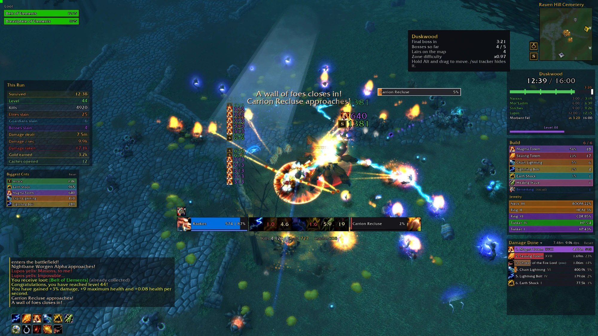
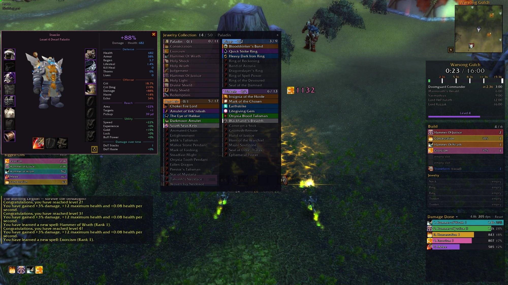

# Survivor UI и Survivor Plates

[English](README.md) | [简体中文](README.zh-CN.md) | Русский

[](https://github.com/morderous/survivor-ui/releases/latest) [](https://ko-fi.com/morderous)





Два интерфейсных аддона для Azeroth Survivors — игры в духе Vampire Survivors, которая работает на [benilla](https://github.com/samwhosung/benilla), клиенте World of Warcraft 1.12.1. Аддоны независимы: можно поставить любой из них или оба.

Аддоны сделаны игроками и не связаны ни с игрой, ни с её автором.

> **Лаунчер (.exe) необязателен.** Аддоны — обычные файлы Lua: скачайте `SurvivorUI-vX.Y.zip` из [последнего релиза](https://github.com/morderous/survivor-ui/releases/latest), распакуйте и положите папки `SurvivorUI` и `SurvivorPlates` в папку игры `benilla-config\AddOns` (см. [вручную](#вручную)). Лаунчер лишь избавляет от этих шагов и умеет кое-что ещё ([с помощью лаунчера](#с-помощью-лаунчера-проще-всего)); его исходный код лежит в [`installer/`](installer), и его может прочитать любой.

## Русский язык

Язык берётся из настроек игры. Когда игра на русском, Survivor UI пишет по-русски: трекер забега, счётчик урона, полосы боссов, история забегов, стражи, полоса опыта, подсказки, окно настроек (`/sui opt`) и ответы команд в чате. Игровые названия и термины — те же, что в самой игре.

С русским языком аддон пишет шрифтом **Exo 2**, в котором есть кириллица; он идёт с аддоном. Глобальный шрифт можно сменить: список предлагает только шрифты с буквами языка игры; из шрифтов аддона кириллица есть в Exo 2, Fira Sans, Noto Sans, Noto Sans SC и Russo One.

## Установка

Два способа с одинаковым результатом: лаунчер или распаковка вручную.

### С помощью лаунчера (проще всего)

1. Скачайте `SurvivorUI-Installer.zip` из [последнего релиза](https://github.com/morderous/survivor-ui/releases/latest) и распакуйте.
2. Откройте `SurvivorInstaller.exe`. Программа новая и не подписана, поэтому Windows может написать «Система Windows защитила ваш компьютер»: нажмите **Подробнее**, затем **Выполнить в любом случае**.
3. Лаунчер сам найдёт игру. Если она лежит в другом месте, нажмите **Указать игру...** и выберите `AzerothSurvivors.exe` в папке игры. Обычное место:
   ```
   C:\Git\wenilla\benilla-config\AzerothSurvivors.exe
   ```
4. На вкладке **Аддоны** Survivor UI стоит первым (рекомендуется): нажмите **Установить**, затем на вкладке **Играть** — **▶ Играть**. Если игра открыта, перезапустите её.

Игры ещё нет? Нажмите **↓ Получить игру**: лаунчер скачает Azeroth Survivors с собственных серверов её автора Aethus (wow.aethus.pl, с его согласия) или с зеркал. Сначала он замеряет скорость: берётся наше собственное зеркало, если оно не слишком медленное, иначе самое быстрое. Каждый пакет проверяется по размеру и sha256, которые дал Aethus; игра ставится в обычное место, и вместе с ней устанавливается Survivor UI.

Ещё лаунчер (Azeroth SurvivorUI Launcher) умеет: запускать игру (**Играть**), ждать в трее и раз в полчаса проверять обновления, обновлять сам себя, делать резервные копии сохранения и восстанавливать их (**Сохранение**), показывать время в игре и статистику сохранения (**Статистика**), показывать историю забегов Survivor UI (**История забегов**), а на вкладке **Аддоны** — ставить другие аддоны из списка, проверенного morderous, каждый из последнего релиза его автора (кладётся только папка аддона и файлы, какие бывают у аддонов, — никогда не программы). Кнопкой **Добавить с GitHub...** можно вставить ссылку на репозиторий GitHub и добавить аддон в свой список (он хранится только на вашем компьютере и никуда не отправляется). На компьютере, где лаунчера раньше не было, он сам ставит Survivor UI и SurvivorUI Classic, как только игра на месте; когда у них выходит новая версия, они обновляются сами, если игра закрыта (отключается флажком **Автообновление** на вкладке **Аддоны**). Лаунчер бывает на английском, китайском и русском: язык меняется в поле **Язык** на вкладке **Играть**. Пока язык не выбран, лаунчер следует языку игры.

### Вручную

1. Скачайте `SurvivorUI-vX.Y.zip` из [последнего релиза](https://github.com/morderous/survivor-ui/releases/latest).
2. Распакуйте в папку аддонов игры `benilla-config\AddOns\`, чтобы получилось `AddOns\SurvivorPlates` и `AddOns\SurvivorUI`. Если нужен только один, оставьте только его.
3. Перезапустите игру.

Чтобы удалить аддон, удалите его папку.

## Основные команды

**Нажмите кнопку S у миникарты** (или введите `/sui opt`), чтобы открыть настройки: каждый элемент и каждый вид можно включить или выключить, задать размер панелей, а **Двигать UI** включает режим перемещения с сеткой (щелчок правой кнопкой по кнопке S открывает его сразу). В любой момент **удерживайте Alt**, чтобы увидеть всё, что можно переместить, и перетащить. Каждый элемент запоминает своё место.

| Команда | Что делает |
|---|---|
| `/sui opt` | Окно настроек |
| `/sui` | Список всех команд в чате |
| `/sui layout` | Возвращает все элементы на исходные места |
| `/sui scale 0.85` | Размер всего интерфейса, от 0.6 до 1.4 |
| `/sui center` | Возвращает центральный блок (фреймы и кнопки) под героя |
| `/sui tracker` | Трекер забега: вкл. или выкл. |
| `/sui meter` | Счётчик урона: от Survivor UI или стандартный |
| `/sui bosses` | Полосы боссов: вкл. или выкл. (при новой установке с v3.0.53 выкл.) |
| `/sui damage` | Текст боя: от Survivor UI или стандартный |
| `/sui pace` | Темп убийств (сфера у часов трекера забега): вкл. или выкл. |
| `/sui guardians` | Список стражей: вкл. или выкл. |
| `/sui collection` | Коллекция украшений |
| `/sui chat 10` | Размер текста чата, от 8 до 18 |
| `/splates none` | Без индикаторов или с ними (по умолчанию с ними) |
| `/splates normal` | Индикаторы и на рядовых врагах или нет (по умолчанию); также `elites`, `guardians`, `bosses` |
| `/splates target` | Индикатор цели любого вида или только когда её вид включён (по умолчанию) |
| `/splates suggested` | Только индикаторы союзников: все вражеские выкл. |
| `/splates scale 1.3` | Размер индикаторов, от 0.5 до 2 |

## Survivor UI

- **Трекер забега** (под миникартой, в духе таймера эпохального+ подземелья): зона, оставшиеся жизни, прошедшее время в сравнении с полной длительностью зоны, шкала времени с моментом появления каждого босса, героический уровень и модификаторы (Усиливающий, Кровавый, Взрывной), а также бесконечный режим.
- **Счётчик урона**: по строке на каждый источник урона, с уроном и долей; при наведении — урон в секунду и криты. Щелчок по заголовку переключает на исцеление, урон по боссам или, в совместном забеге, урон группы. Срабатывания талантов и амулетов идут с иконками самой игры и пометкой (талант) или (амулет).
- **Полосы боссов**: вверху экрана все живые боссы и пробуждённые стражи логов, со здоровьем и дебаффами, на любом расстоянии. При новой установке с v3.0.53 выключены, боссов показывают индикаторы; `/sui bosses` возвращает полосы.
- **Список билда**: иконка, ранг и доля урона каждой ячейки заклинаний, а также качество и характеристики украшений (амулет, кольца, аксессуары).
- **Панель «Этот забег»**: те же данные, что на экране победы игры (время выживания, уровень, убийства, элита, стражи, боссы, урон, золото, открытые тайники).
- **Темп убийств**: текущая скорость убийств в сравнении с вашими прошлыми забегами в той же зоне и на той же сложности.
- **Полоса опыта**: прогресс до уровня, Удача и шансы карт каждой редкости.
- **Стражи**: направление на каждое логово, расстояние, состояние и время возрождения.
- **Миникарта**: метки тайников и логов; те, что вне досягаемости, ждут на краю миникарты и показывают направление.
- **История забегов**: урон, билд, украшения, боссы, сложность и модификаторы каждого забега.
- **Коллекция украшений**: все амулеты, кольца и аксессуары из кодекса игры, найденные и ещё не найденные.
- Фреймы, панель команд, эффекты, плоские панели чата и подсказок, список добычи, лучшие криты и числа боя с иконками заклинаний рядом с героем.

## Survivor Plates

Индикаторы здоровья. **По умолчанию индикаторы включены для элиты, стражей логов и боссов**, с именем на каждом, и выключены для рядовых врагов (`/splates normal` включает их). Каждый вид включается и выключается отдельно в `/sui opt`, раздел «Индикаторы», и каждый выбор запоминается.

- Тонкая полоса в чёрной обводке, имя над ней, доля здоровья мелко внутри, справа.
- Каждый вид своего цвета и чуть крупнее: рядовые — красные, элита — зелёная, стражи логов — синие, боссы — фиолетовые, финальный босс — оранжевый. С версией игры 0.139.2 вид каждого сообщает сама игра, поэтому у стража и элиты с одним именем свои цвета.
- Череп над именем: костяной у элиты, метка логова у стража, рогатый череп инфернала у босса и финального босса.
- В толпе индикатор босса впереди, за ним стража, потом элиты; рядовые — позади и чуть бледнее (ваша цель — никогда).
- Индикатор цели в золотой обводке и показывает её дебаффы и их стаки.
- Индикатор под мышью подсвечивается, выходит вперёд и принимает щелчок, так что из толпы можно выбрать одного. Полоса босса Survivor UI под мышью обводит индикатор своего врага белым.
- Индикаторы союзников тоньше, в золотой рамке, каждый вид отдельно и по умолчанию вкл.: ваши питомцы, призванные существа и тотемы — мятного цвета, а в совместном забеге союзники — цвета своего класса.

## Ограничения

Они идут от клиента 1.12, и аддон не может их обойти:

- Индикаторы появляются только в пределах 20 м от героя.
- На картах подземелий клиент не сообщает, где герой, поэтому на миникарте нет меток тайников и логов, а у стражей нет направления и расстояния.
- Дебаффы можно прочитать только у текущей цели, поэтому их показывает только индикатор цели.

## История изменений

### v3.0.55, 03.11.2026

Своя вкладка для кнопок миникарты — с вашим порядком, вашими цветами и живым превью, — и эффекты союзников с любой стороны фреймов группы.

**Кнопки миникарты**
- **Своя вкладка:** новая вкладка настроек **Кнопки миникарты**, после «Миникарты», отвечает за квадраты у миникарты: живое превью у угла миникарты, затем строка для каждой кнопки с переключателем, двумя стрелками для перемещения в порядке и — у эффектов заклинаний, звуковых эффектов и кольца дальности — своей клавишей. Переключатели и клавиши переехали сюда со вкладки «Миникарта».
- **Ваш порядок:** первой может быть любая кнопка, в том числе [S], и каждую можно показать или скрыть. Если скрыть [S], `/sui` всё равно открывает настройки.
- **Ваши цвета:** каждая кнопка цвета класса (как раньше) или одного из девяти других: золотой, белый, красный, оранжевый, зелёный, бирюзовый, синий, фиолетовый или розовый. Квадрат руководства, как и раньше, сначала золотой. **Все в этот цвет** красит все кнопки одинаково.
- **Направление, размер и отступ:** столбец вверх (как раньше) или вниз либо строка влево или вправо; квадраты от 12 до 28 (раньше 16) и отступ между ними от 0 до 12.
- **Двигаются вместе:** в режиме перемещения это теперь один элемент, **Кнопки миникарты**, и весь ряд движется целиком; заданное раньше место сохраняется.

**Фреймы группы**
- **Эффекты с любой стороны:** эффекты союзников могут стоять слева от их фреймов (как раньше), справа, над ними или под ними. Над или под — фреймы раздвигаются на ряд эффектов; справа — пока вы их не переместили, фреймы стоят левее вашего, чтобы эффекты поместились. Вкладка «Группа»: **Эффекты**.
- **Превью расположения:** вкладка «Группа» рисует полную группу рядом с вашим фреймом так, как она будет выглядеть: порядок, сторону эффектов, поверженного союзника и далёкого. Образцы, которые видны при расстановке фреймов, тоже показывают эффекты.

### v3.0.54, 03.11.2026

Боссы и пробуждённые стражи двигаются на миникарте, щит — в числах здоровья, эффекты союзников и расстояние до них — на фреймах группы, дебаффы — внутри индикаторов, и кнопка для кольца дальности.

**Миникарта**
- **В движении** (попросил ZA5TEESH): метка логова пробуждённого стража следует за стражем, пока он сражается, и возвращается к логову, когда он убит. У каждого босса — рогатый череп, который движется вместе с ним, у финального босса — в оранжевом сиянии. Элите тоже можно дать костяной череп (выкл.). Вкладка «Миникарта»: **Логово за стражем**, **Боссы** и **Элита**.
- **Кнопка кольца дальности** (попросили Silveryxd и sh1Neee): кольцо над кнопкой звука одним щелчком скрывает кольцо дальности — на миникарте и вокруг вас; следующий щелчок возвращает кольца, которые были включены. И своя клавиша, по умолчанию нет.

**Индикаторы** (Survivor Plates)
- **Дебаффы внутри:** у элиты, стражей и боссов наши дебаффы — маленькими значками внутри полосы, слева направо. У вашей цели среди рядовых они остаются над индикатором. Выключаются в **Дебаффы в полосе** («Индикаторы», «Вид»).

**Фреймы юнитов**
- **Щит в числах:** пока на вас щит, числа здоровья учитывают и его, светло-голубым, доля сверх 100%: `878 | 155%`. Выключается в **Щит в здоровье** («Фреймы юнитов»).

**Фреймы группы** (попросили Jocke и ebgl_menios)
- **Эффекты:** эффекты каждого союзника маленькими значками у его фрейма; наведите на значок, чтобы узнать, что это.
- **Расстояние:** дальше 30 м фрейм союзника бледнеет и показывает расстояние (`33 м | 73%`); при наведении видно, сколько метров. Лечение и щиты в этой игре только свои, так что это — чтобы держаться группой. Вкладка «Группа»: **Эффекты союзников** и **Расстояние**.

**Карты**
- **Панель характеристик над картами:** панель характеристик может оставаться на виду, пока вы выбираете карты уровня (в настройках — **Во время выбора карт**).

### v3.0.53, 02.11.2026

Новые индикаторы в стиле SurvivorUI Classic: элиту, стражей и боссов различает сама игра. Световые лучи над тайниками, кольцо вашей дальности, курсор мыши поверх экранов игры и знаки в истории забегов.

**Индикаторы** (Survivor Plates)
- **Новый вид:** тонкая полоса в чёрной обводке со слегка скруглёнными углами, имя над ней, доля здоровья мелко внутри, справа.
- **У каждого вида свой:** рядовые — красные, элита — зелёная, стражи логов — синие, боссы — фиолетовые, финальный босс — оранжевый, каждый чуть крупнее. Вид каждого сообщает игра (её 0.139.2), поэтому у стража и элиты с одним именем свой цвет.
- **Черепа над именем:** костяной у элиты, метка логова у стража, рогатый череп инфернала у босса и финального босса.
- **Впереди:** в толпе индикатор босса поверх всех, за ним стража, потом элиты; рядовые — позади и чуть бледнее (ваша цель — никогда).
- **Ваша цель:** золотая обводка вокруг индикатора, дебаффы над ним.
- **Мышь:** индикатор под ней мягко подсвечивается и выходит вперёд; когда щелчки проходят сквозь индикаторы, щелчок принимает только он. Полоса босса под мышью обводит индикатор своего врага белым.
- **Союзники:** индикаторы тоньше, в золотой рамке: союзник в совместном забеге — цвета своего класса, ваши питомцы, призванные существа и тотемы — мятного цвета.
- **Включены у всех, один раз:** индикаторы включаются (даже если вы их выключали), рядовые — выкл.; элита, стражи, боссы, питомцы, тотемы и союзники — вкл.; имя на каждом индикаторе. Потом всё это меняется на вкладке настроек «Индикаторы» и командой `/splates`.
- **Ваша цель любого вида** (новое, выкл.): если включено, у вашей цели есть индикатор, даже когда её вид выключен.
- **С метками в мире:** большая метка логова отходит в сторону, пока виден индикатор его стража, а с **Рисовать метки врагов** метка стоит слева от полосы индикатора.

**Метки в мире**
- **Световые лучи над тайниками:** столб золотого света над каждым тайником, световое пятно под ним и сундук, медленно покачиваясь, парит у вершины, с расстоянием. Вдали тоньше и короче, бледнее там, где перед ним стоит ваш герой. Если выключить (**Световые лучи над тайниками**), сундук, как раньше, у земли.
- **Ваша дальность** (идея ProTecz): светло-голубое кольцо на дальность самого дальнобойного атакующего заклинания вашего билда, без лечения, щитов, баффов и расовых способностей: на миникарте и точками на земле вокруг героя. Оба вкл., каждое отдельно в разделе **Ваша дальность**. Кольцо меняется вместе с билдом.

**Курсор мыши**
- **Поверх экранов игры** (сообщил Nomad): цветная латная рукавица остаётся над карточками нового уровня и сокровищ, где раньше возвращался курсор игры. Меню игры по Esc закрывает всё, что рисует аддон, поэтому там, где Esc не ставит на паузу (совместный забег, город, «Двигайтесь, чтобы начать»), вид «Латная рукавица» — это рукавица самой игры, с эффектами вокруг.

**История забегов**
- **Знаки забега** (попросил jiminee): в блоке «Добыча» у заголовка указаны знаки, заработанные в забеге, а при наведении на них видны знаки каждого босса и итог вашего класса, как в карточке списка добычи. У забегов, сохранённых раньше, блок остаётся прежним.

**Новые значения по умолчанию** (для новой установки)
- **Полосы боссов выкл.:** теперь боссов показывают индикаторы. `/sui bosses` возвращает полосы; у кого они есть, у того и остаются.
- **Рейдовые метки:** боссы, стражи и элита отмечены, метки нарисованы над ними.
- **Трекер забега:** стражи числом («Живых: 4 / 4») вместо полосы, без строки уровня и опыта.

### v3.0.52, 02.11.2026

Метки прямо в мире с версией игры 0.139.2: поверженные союзники, тайники, логова и метки ваших врагов — там, где они находятся. Две новые страницы руководства: Скорость и Скорость передвижения.

**Метки в мире** (новая вкладка настроек, «Интерфейс»)
- **Поверженные союзники:** в совместном забеге — золотой крест над поверженным союзником, с его именем и расстоянием. Его фрейм группы тоже показывает расстояние: «ПОВЕРЖЕН 23 м».
- **Тайники:** сундук над каждым оставшимся тайником и расстояние до него.
- **Логова:** имя стража над его логовом, пока он спит. Когда страж пробуждается, имя следует за ним из логова; когда он убит, имя возвращается на логово со временем до возвращения стража.
- **Стрелки:** для поверженных союзников, тайников и логов вне поля зрения — стрелки на кольце вокруг вас в сторону нескольких ближайших, с расстоянием.
- **Взрывные сферы:** в забеге с аффиксом «Взрывной» — пульсирующая метка над каждой сферой.
- **Полосы над элитой, стражами и боссами** (поначалу выкл., эксперимент): имя и здоровье над ними, без индикатора.

**Рейдовые метки**
- **Нарисованные метки:** при включённой настройке **Рисовать метки врагов** (она включена изначально) каждый босс, страж и элитный враг отмеченного на вкладке «Рейдовые метки» вида сразу получает свою метку, нарисованную над ним, а ваша цель никогда не меняется. Их видите только вы. Если выключить — рейдовые метки игры, как раньше. У героев кооператива остаются метки игры.

**Текст боя**
- **Дальние числа бледнее** («Показывает»): при числах над врагами удары по врагам дальше 20 м от вас бледнеют.

**Руководство**
- **Скорость:** все бонусы к восстановлению складываются в одно число, и каждое ожидание делится на 1 плюс это число. Игра показывает Скорость как то, насколько быстрее, поэтому её 50% уже означают вдвое больше заклинаний, а 75% — вчетверо больше. Предела нет, но ни одно заклинание не восстанавливается быстрее чем за 0.25 сек. У **Эха** предела тоже нет: сверх 100% каждое заклинание бьёт дважды, а остаток — вероятность третьего удара, и каждый удар — полноценное применение: заклинание заново выбирает цель и отдельно проверяет Крит. Ползунки для обоих, применения заклинания в минуту шариками и удары одного применения.
- **Скорость передвижения:** Скорость передвижения ограничена +120%, это 15.4 м в секунду. Бонусы к Подбору перемножаются, поэтому два бонуса дают больше их суммы. Область расширяет каждый радиус и охват: +100% удваивают радиус и покрывают вчетверо большую площадь.
- **На китайском:** обе страницы на китайском, когда игра на китайском.

### v3.0.51, 02.11.2026

Исправление для v3.0.50. Спасибо N3x и Amarolk за сообщение.

**Исправлено**
- **Кнопка настроек на миникарте:** после первых карт уровня она оставалась невидимой до следующей перезагрузки интерфейса, хотя щелчок и подсказка по-прежнему её находили. Теперь она возвращается вместе с остальной миникартой.

### v3.0.50, 02.11.2026

Две новые страницы руководства об экипировке, «Знаки» и «Комплекты», а карты уровня теперь ничем не закрыты, если вы сами не попросите.

**Руководство**
- **Знаки:** сколько стоит каждая звезда предмета для каждой редкости и сколько стоят все 8 предметов до 3 и до 5 звёзд. **Готово у других классов** задаёт, у скольких других ваших классов этот комплект готов: каждый даёт скидку 5%, до 40%, как считает игра. Там же три звезды, которые что-то открывают в комплекте, а наведение на «Усиленный» показывает, что он даёт вашему классу.
- **Комплекты:** шесть комплектов каждого класса, их бонусы за 4 и 8 предметов с числами и зоны, где каждый выпадает. Выберите класс (открывается ваш) и звёзды: 4 предмета, 8 предметов или «Усиленный». Подсвечивается часть каждого комплекта, которую дают эти звёзды, а на «Усиленном» растущие числа становятся золотыми. Название каждого комплекта окрашено в его цвет, как у предмета в подсказке.
- **На китайском:** обе страницы на китайском, когда игра на китайском, со словами самой игры для комплектов, зон и бонусов.

**Карты уровня**
- **Скрыто, пока вы выбираете карту:** на маленьком экране карты игры крупные, и элементы Survivor UI стояли на них. Теперь каждый элемент скрывается, пока вы выбираете карту или новое украшение, и возвращается после.
- **Что оставить — решаете вы:** на вкладке настроек «Расположение» в разделе **Во время выбора карт** есть **Скрывать всё во время выбора карт**, а под ним флажок для каждого элемента: трекер забега, список билда, надетые украшения, счётчик урона, «Этот забег», «Лучшие криты», полоса опыта, миникарта, чат, полосы боссов, фреймы группы и всё остальное. Снимите первый флажок, чтобы всё было как раньше, или отметьте, например, только счётчик.
- **Одно уведомление:** когда вы впервые ждёте в городе или на «Двигайтесь, чтобы начать», появляется окно с кнопками **Оставить скрытым**, **Показывать как раньше** и **Выбрать элементы**.

**Исправлено**
- **Строка повышения уровня в чате** (игра 0.139): «Вы получили 3% к урону...» снова появлялась с каждым уровнем, потому что игра больше не присылает событие повышения уровня в забеге. При включённом пункте **Новые уровни** на вкладке настроек «Чат» она снова скрыта, на любом языке.

Полное описание и изменения каждой версии — в [README на английском](README.md#changes).
