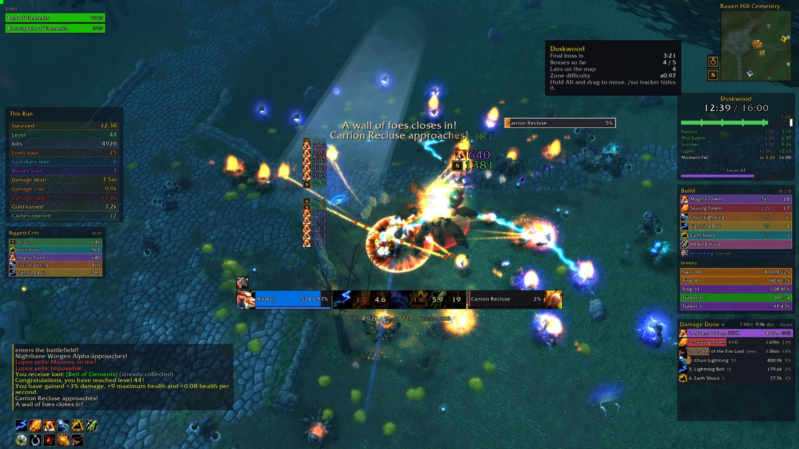

# Survivor UI 与 Survivor Plates

[English](README.md) | 简体中文

[](https://github.com/morderous/survivor-ui/releases/latest) [](https://ko-fi.com/morderous)



为《Azeroth Survivors》制作的两个界面插件。这是一款类似《吸血鬼幸存者》（Vampire Survivors）的游戏，运行在 [benilla](https://github.com/samwhosung/benilla)（魔兽世界 1.12.1 客户端）上。两个插件相互独立：可以只用其中一个，也可以两个都用。

本插件由玩家制作，与游戏及其作者无关。

> **安装器（.exe）是可选的。** 插件只是普通的 Lua 文件：从[最新版本](https://github.com/morderous/survivor-ui/releases/latest)下载 `SurvivorUI-vX.Y.zip`，解压后把 `SurvivorUI` 和 `SurvivorPlates` 两个文件夹放进游戏的 `benilla-config\AddOns` 文件夹即可（见[手动安装](#手动安装)）。安装器只是帮你省去这些步骤，它的源代码在 [`installer/`](installer) 中，任何人都可以查看。

## 中文支持

游戏语言为中文时，Survivor UI 以中文显示：冒险追踪、伤害统计、首领血条、冒险历史、守护者、经验条以及各种提示。中文使用插件自带的 **Noto Sans SC** 字体，避免游戏引擎在中英文混排时把字形弄错（英文字母被画成汉字，或反过来）。

选项窗口（`/sui opt`）和聊天命令暂时仍为英文。

## 安装

两种方式，结果相同：用安装器，或手动解压。

### 用安装器（最简单）

1. 从[最新版本](https://github.com/morderous/survivor-ui/releases/latest)下载 `SurvivorUI-Installer.zip` 并解压。
2. 打开 `SurvivorInstaller.exe`。程序较新且没有签名，Windows 可能提示“Windows 已保护你的电脑”：点击 **更多信息**，再点击 **仍要运行**。
3. 安装器会自己找到游戏。如果你的游戏在别处，点击 **Find game...**，选择游戏文件夹中的 `AzerothSurvivors.exe`。常见位置：
   ```
   C:\Git\wenilla\benilla-config\AzerothSurvivors.exe
   ```
4. 在 **Addons** 标签页，Survivor UI 排在第一位（推荐）：点击 **Install**，然后在 **Play** 标签页点击 **Play**。如果游戏开着，重启游戏。

还没有游戏？点击 **Get the game**：它从作者 Aethus 自己的服务器（wow.aethus.pl，经他同意）或游戏 Discord 提供的镜像下载《Azeroth Survivors》，先测速并选最快的，按 Aethus 给出的大小和 sha256 校验后放到常用位置，并一起装好 Survivor UI。

安装器（Azeroth SurvivorUI Launcher）还可以：启动游戏（**Play**）、在托盘中等待并每半小时检查一次更新、自我更新、备份和恢复存档（**Savegame**）、显示游戏时长与存档统计（**Statistics**）、查看 Survivor UI 的冒险历史（**Run History**），并在 **Addons** 标签页安装 morderous 检查过的其他插件，每个都取自作者自己的最新版本（只放入插件自己的文件夹和插件类文件，从不放程序）。界面为英文。

### 手动安装

1. 从[最新版本](https://github.com/morderous/survivor-ui/releases/latest)下载 `SurvivorUI-vX.Y.zip`。
2. 解压到游戏的插件文件夹 `benilla-config\AddOns\`，得到 `AddOns\SurvivorPlates` 和 `AddOns\SurvivorUI`。只想用其中一个就只保留那一个。
3. 重启游戏。

删除插件只需删除它的文件夹。

## 常用命令

**点击小地图旁的 S 按钮**（或输入 `/sui opt`）打开选项：每个部件的开关和外观、面板大小，以及 **Move UI**（带网格的移动模式，右键 S 按钮可直接进入）。随时**按住 Alt** 可以看到所有可移动的部件并拖动它们。每个部件都会记住自己的位置。

| 命令 | 作用 |
|---|---|
| `/sui opt` | 选项窗口 |
| `/sui` | 在聊天中列出所有命令 |
| `/sui layout` | 把所有部件放回初始位置 |
| `/sui scale 0.85` | 整个界面的大小，0.6 到 1.4 |
| `/sui center` | 把中间的框体和动作条放回英雄下方 |
| `/sui tracker` | 冒险追踪：开或关 |
| `/sui meter` | 伤害统计：Survivor UI 的或游戏默认的 |
| `/sui bosses` | 首领血条：开或关 |
| `/sui damage` | 战斗数字：Survivor UI 的或游戏默认的 |
| `/sui pace` | 击杀节奏（冒险追踪时钟旁的光球）：开或关 |
| `/sui guardians` | 守护者列表：开或关 |
| `/sui collection` | 首饰收藏 |
| `/sui chat 10` | 聊天文字大小，8 到 18 |
| `/splates none` | 无姓名板（默认）或开启姓名板 |
| `/splates all` | 所有敌人都显示姓名板，或只显示精英、守护者和首领 |
| `/splates suggested` | 推荐设置：友方姓名板开，敌方姓名板关 |
| `/splates scale 1.3` | 姓名板大小，0.6 到 2 |

## Survivor UI

- **冒险追踪**（小地图下方，类似大秘境计时器）：区域、剩余生命、已用时间与区域总时长、每个首领的时间轴和出现时间、英雄难度与本周词缀（激励、血池、易爆），以及无尽模式。
- **伤害统计**：每个伤害来源一条，显示伤害和占比；悬停查看每秒伤害和暴击。点击标题切换为治疗量、首领伤害，或合作模式中的队伍伤害。天赋和项链的触发效果带有游戏自己的图标，并标注（天赋）或（项链）。
- **首领血条**：屏幕顶部显示所有存活的首领和已苏醒的巢穴守护者，带生命值和减益效果，不限距离。
- **构筑列表**：每个技能槽位的图标、等级和伤害占比，以及首饰（项链、戒指、饰品）的品质和属性。
- **本次冒险面板**：与游戏胜利界面相同的数据（存活时间、等级、击杀、精英、守护者、首领、伤害、金币、开启宝箱）。
- **击杀节奏**：与你在同一区域、同一难度的历史冒险比较当前的击杀速度。
- **经验条**：升级进度、幸运值，以及每种稀有度卡牌的出现几率。
- **守护者**：每个巢穴的方向、距离、状态和重生时间。
- **小地图**：宝箱和巢穴的标记，超出范围的会停在小地图边缘指示方向。
- **冒险历史**：每次冒险的伤害、构筑、首饰、首领、难度和词缀。
- **首饰收藏**：游戏图鉴中所有的项链、戒指和饰品，已找到的和尚未找到的。
- 单位框体、动作条、Buff、平面风格的聊天框和提示框、拾取列表、最高暴击，以及英雄身旁带技能图标的战斗数字。

## Survivor Plates

姓名板插件。**默认没有姓名板**：Survivor UI 的首领血条已经显示所有首领、守护者和精英的生命值。要开启姓名板，在 `/sui opt` 的 Nameplates 中选择，或输入 `/splates none`。

- 扁平的生命条，名字在上，生命值在条上。
- 30% 生命处有标记（斩杀效果开始的位置），低于它时条变黄。
- 精英和首领的姓名板更大，有各自的颜色。
- 目标的姓名板显示它的减益效果和层数。
- 友方姓名板（默认关闭）：你的图腾、宠物和召唤物，以及合作冒险中的队友（职业颜色）。

## 限制

以下来自 1.12 客户端，插件无法绕过：

- 姓名板只在英雄 20 码内出现。
- 在副本地图中，客户端不提供英雄的位置，小地图上没有宝箱和巢穴标记，守护者也没有方向和距离。
- 减益效果只能从当前目标读取，所以只有目标的姓名板显示它们。

## 更新记录

完整的说明和每个版本的更新记录见[英文 README](README.md#changes)。
